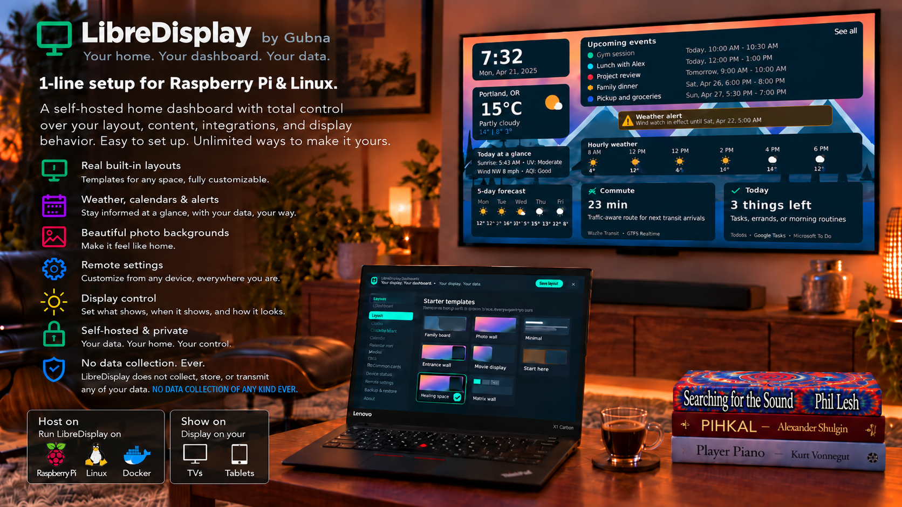

# LibreDisplay


**Your home. Your dashboard. Your data.**  
Free, open-source, self-hosted home dashboards for Raspberry Pi, Docker, NAS, mini PCs, and modern browsers.

<p align="center">
  
</p>

## Quick start — Raspberry Pi

Use a current Raspberry Pi OS **with Desktop**, then paste this into Terminal:

```bash
bash -c "$(curl -fsSL https://raw.githubusercontent.com/Gubna-Tech/LibreDisplay/v1.15.0/scripts/install-one-line.sh)"
```

The bootstrap validates the pinned **v1.15.0** release before starting the installer. It will not overwrite an existing `~/libredisplay`; existing users should use `libredisplay update`. Reboot when prompted.

> Raspberry Pi OS Lite is not supported by the native kiosk installer. A native Pi can, however, be switched to **Server-only mode** after installation so it runs LibreDisplay without launching a local webpage. Docker/NAS/Linux server deployments are already server-style hosts.

## First setup

A new installation opens the setup wizard automatically. It walks through the display name, exact weather location, calendars, background, performance, alerts, appearance, Remote Access, **Pi host mode**, and recovery.

Choose **Display + server** for a normal wall dashboard, or **Server only** when the Pi should host LibreDisplay for other Pis/tablets/TVs/browsers without opening Chromium locally. You can change this later under **Settings > System > Raspberry Pi host mode** or over SSH with `libredisplay server-only on|off`.

For the full task-oriented installation, setup, Settings, terminal, troubleshooting, recovery, deployment, and reference handbook, see **[HELP.md](HELP.md)**.

## Using LibreDisplay

<details>
<summary><strong>Features &amp; highlights</strong></summary>

- Weather, forecasts, alerts, NatureScape scenes, and optional dog companion
- Compact glass hourly micro-cards plus optional larger Showcase forecast scenes with selectable landscape themes
- ICS/iCalendar feeds, `.ics` imports, plus optional holiday/astronomy add-ons
- Stock, Google Photos, local media, and NAS backgrounds
- Family, chores, rewards, tasks, alerts, integrations, and custom data
- Per-display layouts, themes, accessibility, and deep Arrange controls
- Multiple displays, Owner/Editor/Viewer roles, and read-only Display Links
- One-time Owner-device enrollment with short codes and QR setup
- Raspberry Pi **Display + server** and **Server-only** host modes
- OLED care: dimming, quiet hours, deep protection, and pixel shifting
- Self-hosted operation with no LibreDisplay cloud account or telemetry

</details>

### Compatible devices

| Device / role | Run server | Native wall kiosk | Server-only host | Read-only viewer | Remote settings |
|---|:---:|:---:|:---:|:---:|:---:|
| Raspberry Pi 3 / 4 / 5 + Pi OS Desktop | ✅ | ✅ | ✅ | ✅ | ✅ |
| Linux mini PC / Docker host | ✅ | ❌ | ✅ | ✅ | ✅ |
| NAS with Docker / Compose | ✅ | ❌ | ✅ | ❌ | ✅* |
| Tablet, TV, phone, or desktop browser | ❌ | ❌ | ❌ | ✅ | ✅ |

\*Use a browser connected to the LibreDisplay server.

For local media or NAS shares, run the helper you need: `~/libredisplay/scripts/setup-media.sh` or `~/libredisplay/scripts/setup-nas.sh`.

## FAQ and troubleshooting

> [!TIP]
> **Start here when something is unclear.** The FAQ is split into small, collapsible topics so you can scan it like a human instead of opening one giant wall of text. For step-by-step procedures and deeper explanations, use the **[LibreDisplay Help & Setup Guide](HELP.md)**.

<details>
<summary><strong>Installation, first setup, and privacy</strong></summary>

**Does LibreDisplay require a cloud account?**  
No. LibreDisplay is self-hosted. External weather, calendar, photo, or integration providers are contacted only when you choose to use them.

**Does LibreDisplay send analytics or telemetry?**  
LibreDisplay does not require analytics or telemetry. Your dashboard configuration lives on your server.

**What should I do immediately after installation?**  
Complete the setup wizard, verify the exact weather location, choose the Pi host mode, create a recovery baseline, then add only the features you need.

**Can I rerun the setup wizard?**  
Yes. Use **Settings > Home > Run setup wizard**. The full Settings interface remains available at all times.

**Should I expose LibreDisplay directly to the public Internet?**  
No. Keep it on a trusted LAN or private VPN. Do not port-forward the built-in web server.

**Where is the detailed documentation?**  
Open **[HELP.md](HELP.md)** for installation, configuration, every major Settings area, terminal commands, troubleshooting, recovery, and tips.

</details>

<details>
<summary><strong>Raspberry Pi, displays, and Server-only mode</strong></summary>

**What is Server-only mode?**  
The Pi keeps the LibreDisplay server running but does not launch the local Chromium dashboard. Other devices can still display and manage dashboards from that Pi.

**How do I enable or disable Server-only mode?**  
Use the first-run wizard, **Settings > System > Raspberry Pi host mode**, or SSH: `libredisplay server-only on` / `libredisplay server-only off`.

**If I turn Server-only mode on, how do I get the local dashboard back?**  
SSH into the Pi and run `libredisplay server-only off`. The local Chromium kiosk should launch shortly afterward without stopping the server.

**Can one LibreDisplay server run several screens?**  
Yes. Named display endpoints can use independent settings/layouts and separate read-only Display Links while sharing one server.

**Can a phone, tablet, TV, or desktop be a viewer?**  
Yes. Any compatible browser that can reach the server can use a read-only Display Link.

**Which Raspberry Pi models are supported?**  
Pi 3, Pi 4, and Pi 5 with Raspberry Pi OS Desktop are supported by the native installer. Device-aware performance behavior reduces load on weaker hardware.

**Can I use Raspberry Pi OS Lite?**  
Not with the native kiosk installer. Install on Pi OS Desktop and switch to Server-only mode, or use a Docker/server deployment.

</details>

<details>
<summary><strong>Remote Access, Owner devices, and connection addresses</strong></summary>

**How do I add an Owner device?**  
Enable Remote Access, choose **Add Owner Device**, then scan the QR or open the displayed `/connect` address and enter the short-lived one-time code.

**Do I still need to copy a long Owner pairing URL?**  
No. New Owner devices use the stable `/connect` address plus a short-lived one-time code, or the QR for one-scan setup. Existing `/pair?access=…` links remain accepted temporarily for upgrade compatibility but are no longer the normal setup workflow.

**Can I create a connection code over SSH?**  
Yes. Run `libredisplay connect`. Use `libredisplay addresses` to print the stable connection/login addresses first.

**What is an Owner device?**  
A trusted browser with Owner privileges. Owner devices can be named, reviewed, and revoked individually.

**Can an existing Owner authorize another Owner device?**  
Yes, as long as Remote Access remains enabled.

**What if `.local` addresses do not work?**  
Run `libredisplay addresses` and use a numeric private-LAN address shown there.

**What is `/login` for?**  
It is the stable sign-in/reconnect page for named Owner, Editor, or Viewer accounts.

**What is a Display Link?**  
A separate read-only credential scoped to one display. It cannot change Settings.

**How do I revoke a lost phone or old computer?**  
Open **Owner devices** in Remote Access and use **Revoke** for that device. Revoking the current browser signs that browser out immediately.

**What does “Reset all remote credentials” do?**  
It invalidates Owner sessions, active one-time codes, legacy pairing credentials, and read-only Display Links without erasing dashboard configuration.

</details>

<details>
<summary><strong>Calendars, weather, backgrounds, and media</strong></summary>

**What calendars are supported?**  
Standard ICS/iCalendar subscription feeds and local `.ics` imports. Sources can be named, colored, ordered, enabled/disabled, and checked independently.

**What are Optional Calendar Add-ons?**  
Opt-in U.S. civic holidays and observances, Christian, Jewish, Islamic, astronomy/clock-change, and cultural events. The U.S. set includes dates such as Presidents’ Day, Columbus/Indigenous Peoples’ Day, Leif Erikson Day, federal Election Day, Flag Day, Patriot Day, Veterans Day, and Thanksgiving. Add-ons are off by default. Each category can be renamed and given its own color, and every built-in date can be individually hidden, renamed, or color-overridden without disabling the rest of its category.

**Why is a calendar missing events?**  
Check that the source is enabled/reachable, verify timezone expectations, then use the feed check/refresh controls. See the calendar troubleshooting section in [HELP.md](HELP.md).

**Can I use local or NAS media?**  
Yes. Native installations include `setup-media.sh` and `setup-nas.sh`; LibreDisplay can also use stock and supported photo sources.

**What happens when LibreDisplay is offline or the Internet goes down?**  
The local server and local content keep working. External providers cannot fetch fresh data; cached last-known-good data may remain available where supported.

</details>

<details>
<summary><strong>Performance, motion, and OLED/display care</strong></summary>

**What if animations feel heavy?**  
Start with Automatic/Balanced performance choices and reduce expensive fullscreen/seasonal/background motion before disabling core dashboard features.

**Why can Pi 3 look less animated than Pi 4/5?**  
Automatic mode deliberately keeps high-cost scenery static on weaker hardware to keep unattended displays responsive. On Pi 3, the dog stays still between synchronized scene refreshes and is repositioned with the refreshed scene instead of continuously walking.

**How do I diagnose slow rendering?**  
Use **Settings > System > Display performance bottleneck test**, or run `libredisplay doctor` and the field-readiness tooling described in [HELP.md](HELP.md).

**Can LibreDisplay protect OLED displays?**  
Yes. Pixel shifting, idle dimming, Quiet Hours, deep-black protection, temporary wake behavior, and related timing/intensity controls are independently configurable.

**Can Quiet Hours be off while pixel shifting stays on?**  
Yes. Display-protection features are intentionally granular rather than bundled.

</details>

<details>
<summary><strong>Updates, backups, recovery, and Terminal</strong></summary>

**How do I check status over SSH?**  
Run `libredisplay status`. For a broader quick check use `libredisplay doctor`.

**How do I see connection addresses?**  
Run `libredisplay addresses`. Add `--include-display-links` only when you intentionally need the credential-bearing read-only links.

**How do I update LibreDisplay?**  
Use **Settings > System > Software update** or run `libredisplay check` followed by `libredisplay update`.

**Are settings preserved during updates?**  
Supported updates preserve configuration, endpoints, local data/media, profiles, and custom plugins while using rollback/recovery safeguards.

**How do I create a backup?**  
Run `libredisplay backup` or the underlying `~/libredisplay/scripts/backup.sh`.

**Can I recover from a bad update?**  
Yes. LibreDisplay keeps update rollback/recovery tooling and backups. See **Recovery** in [HELP.md](HELP.md) before manually editing data files.

**Where can I see logs?**  
Use `libredisplay logs`, `libredisplay logs --type update`, or `libredisplay logs --type rollback`.

</details>

<details>
<summary><strong>Customization, integrations, and common UI problems</strong></summary>

**Can each display have a different layout?**  
Yes. Named displays have independent configuration, and Profiles/Scenes can deliberately reuse or schedule layouts.

**Can I add integrations or custom data?**  
Yes. LibreDisplay includes integrations/plugins and custom data blocks. Only provide credentials to providers you trust.

**Settings looks wrong after an update. What first?**  
Perform a full browser refresh, confirm you are editing the intended named display, then run `libredisplay doctor` if the problem persists.

**The dashboard will not load. What should I check?**  
Run `libredisplay status`, `libredisplay doctor`, and `curl http://127.0.0.1:8787/healthz` from the server. The troubleshooting decision tree in [HELP.md](HELP.md) covers the next steps.

</details>

## Terminal commands

The native Pi installation provides one main CLI:

```bash
libredisplay --help
```

Common commands:

| Task | Command |
|---|---|
| Overall status | `libredisplay status` |
| LAN/VPN addresses | `libredisplay addresses` |
| New Owner connection code | `libredisplay connect` |
| Remote Access status | `libredisplay remote status` |
| Pi host mode status | `libredisplay server-only status` |
| Enable Server-only mode | `libredisplay server-only on` |
| Disable Server-only mode | `libredisplay server-only off` |
| Quick diagnostics | `libredisplay doctor` |
| Recent browser log | `libredisplay logs` |
| Update check | `libredisplay check` |
| Update | `libredisplay update` |
| Sensitive backup | `libredisplay backup` |

See **[HELP.md](HELP.md)** and open **9. Terminal and SSH reference** for complete usage, aliases, and recovery examples.

## Updating LibreDisplay

Native installs show updates in **Settings > System > Software update**. From Terminal:

```bash
libredisplay check && libredisplay update
```

Supported updates keep settings, media, display endpoints, and custom plugins.

## Docker

From the extracted LibreDisplay folder:

```bash
chmod +x scripts/docker-setup.sh && ./scripts/docker-setup.sh --lan
```

For maintenance, use `./scripts/docker-setup.sh update` or `./scripts/docker-setup.sh backup`.

Docker/NAS hosts are already server-oriented and do not use the native Pi Chromium kiosk manager.

## Remote access and privacy

LibreDisplay is for a trusted home network or private VPN. Do **not** port-forward it directly to the public Internet.

Use **Add Owner Device** to authorize a trusted browser with a short-lived, single-use code or QR. `/login` remains available for named-account sign-in/reconnect, and each **Display Link** is read-only for one screen.

LibreDisplay needs no cloud account and sends no analytics or telemetry. External integrations only contact services you choose.

## Documentation

- **[HELP.md](HELP.md)** — comprehensive task-oriented setup, Settings, Terminal, deployment, troubleshooting, recovery, and reference guide
- **[LICENSE](LICENSE)** — MIT License

## Open source

LibreDisplay is released under the **[MIT License](LICENSE)**.  
Copyright (c) 2026 Gubna.